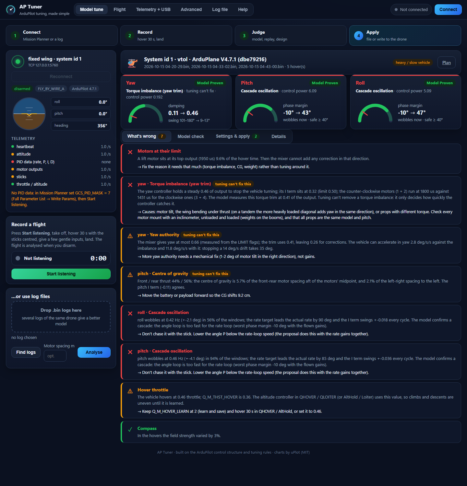
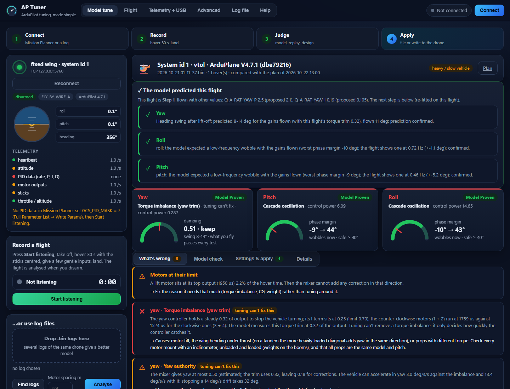
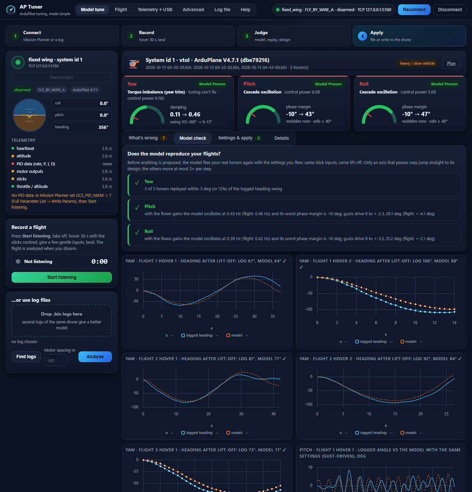
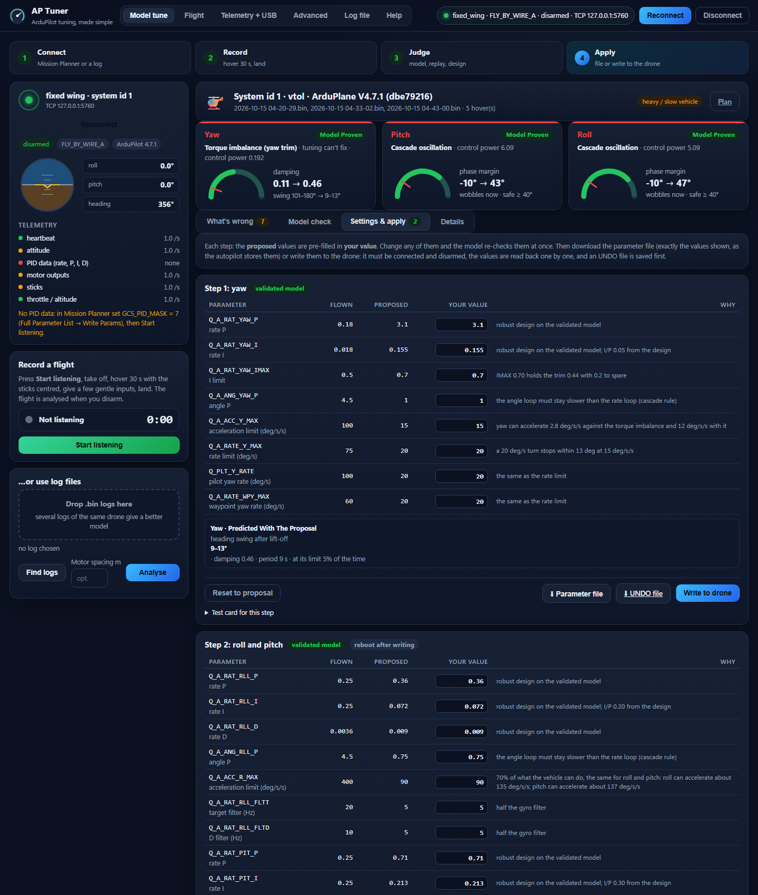

# AP Tuner

Live and log-based tuning of ArduPilot rate PIDs, angle gains and gyro notch filters, for
multirotors, QuadPlane VTOLs, helicopters and fixed-wing planes of any size, including **heavy and slow
drones** (100 kg class), which get their own model-based tuner (the **Model tune** tab, below).

It connects to the vehicle through Mission Planner's MAVLink mirror (or directly to a telemetry
link or a SITL), watches the vehicle fly, identifies the airframe's response, computes gains
with the same controller structure and rules ArduPilot uses, shows everything (graphs, margins,
predicted vs measured step response, diagnostics with a grade), and writes the gains on the ground
(disarmed). Writing to a flying vehicle is **off by default**: the switch **Allow changes in flight** is
experimental and has been tested only in ArduPilot's simulator, never on a real aircraft. With it on, the
gains go to the vehicle in bounded steps, every change is watched and the app tries to undo it when the
vehicle starts to oscillate (see Safety). The same analysis runs on `.bin` logs, including harmonic-notch
design from raw gyro data.

**One edition (C++).** Since 22 Oct 2026 the app is the C++ program in `cpp/` only (the earlier JavaScript
edition was removed; it is in the git history up to commit `35bc01c`). Paths like `src/engine/tuner.js` further
down name the JavaScript module a C++ file was ported from; the C++ file has the same name under `cpp/`.

> **Status: beta (v0.2.0).** The model-based tuner for heavy drones has been proven on one airframe so far (a
> ~100 kg tandem QuadPlane) and predicted two real flights correctly. Read **Status and limitations** below before
> you fly settings from it, and keep the UNDO file of every step.
>
> **Download:** the Windows package is on the [Releases page](https://github.com/jelaniA3R0/ap-tuner/releases/latest)
> (unzip, double-click `Install AP Tuner.cmd`). **Help make it better:** share how a tune flew, report bugs or send
> code: see [Contributing](CONTRIBUTING.md). Changes per version: [CHANGELOG](CHANGELOG.md).

| Model tune: what the flights show | Next-flight check |
|---|---|
|  |  |
| **Model check: the model replays your real hovers** | **Settings & apply: edit, re-check, file or write** |
|  |  |

## Model tune: heavy and slow drones (in plain words)

Big drones are slow: the motors and props take a long time to change thrust, and the angle loop
(stick → angle) can end up faster than the rate loop under it. Then the drone wobbles slowly (about once
every two seconds) or drifts in yaw after every lift-off, and the usual "raise the gains a little" rules can't
find a working tune. The **Model tune** tab does what an engineer would do by hand:

1. **Finds the hovers** in your flights (from logs, or live while Mission Planner is connected).
2. **Finds what's wrong** and says whether tuning can fix it: torque imbalance (yaw trim) with the motor split,
   how much yaw authority is left, centre of gravity from the front/rear thrust split ("move the battery X cm
   forward" when you give the motor spacing), slow wobbles and whether the model confirms a *cascade* (angle
   loop too fast for the rate loop), motors at their limit, vibration that got worse since the last flights
   (props / mounts), hover throttle learning, altitude hold, compass messages.
3. **Builds a model of your drone** from ordinary hovers, as a *range* of possible drones, not one guess.
4. **Proves the model**: it flies your real hovers again with the settings you flew (same stick, same lift-off)
   and compares the heading swing / wobble with the log. Only a proven axis may jump straight to its design.
5. **Designs safe settings for every axis together**: thousands of candidates are tested on every drone of the
   range (phase margin ≥ 40°, gain margin ≥ 10 dB for roll / pitch; damping for yaw), noise no higher than now,
   time simulations of lift-off, gusts, stick steps, extra delay and rotor kick; limits (acceleration, rate,
   pilot yaw rate, IMAX) from what the motors can actually do; one gyro filter for all axes.
6. **Gives you steps** (Settings & apply): the exact values, with the reason for each, the predicted result, an
   **UNDO** file with the values you flew and a short test card. Every value is shown exactly as the autopilot will
   store it (float32 / whole numbers). Then pick one of three ways:
   * **type your own values**: the model re-checks them at once (stability, damping, phase / gain margin, noise,
     limits) and says "safe on the model" or which test fails;
   * **download the parameter file** of exactly the values on screen, and load it in Mission Planner (Full Parameter
     List → Load from file → Write Params);
   * **write to the drone** from the app: only when it is connected, disarmed and is the drone the flights came from.
     You first see the drone's current values next to the new ones; on your OK the app saves an UNDO file, writes
     each value, reads it back, and if one does not hold puts everything back. When the gyro filter changes it offers
     the reboot and reads every value again afterwards.
7. **Checks your next flight**: analyse the next log (or fly with the app listening) and it recognises which step
   you flew, compares the prediction with what happened ("prediction confirmed"), re-fits the model and gives
   the next step, or says to stop.

**Live through Mission Planner:** connect Mission Planner to the drone as usual, press **Connect** in AP Tuner
(it finds Mission Planner's MAVLink mirror by itself), then **Start listening**. Every flight from arming to
disarming is recorded and analysed after landing. It needs `GCS_PID_MASK = 7` for the PID telemetry; the app
tells you if it is off but does not change it. It only asks the autopilot for the telemetry streams, as
Mission Planner does. A telemetry radio is fast enough for this: the motions of a heavy drone are slow
(0.05-3 Hz); only the vibration checks need a log.

Command line: `aptuner-heavy <log.bin> [more.bin ...] [--plan plan.json] [--out folder] [--spacing metres]`.
The method, step by step: `docs/how-it-works.md` ("Model-based tuning"); the tandem QuadPlane it was proven on:
`docs/validation/tandem-hover-logs.md`.

## Install or just run

* **Download** `AP-Tuner-<version>-windows.zip` from the
  [Releases page](https://github.com/jelaniA3R0/ap-tuner/releases) (or build it yourself:
  `powershell -ExecutionPolicy Bypass -File tools\make-release.ps1` with the toolchain of `cpp/README.md`).
* **Install:** unzip it and double-click **`Install AP Tuner.cmd`**: it copies the app to your user folder,
  puts **AP Tuner** on the Desktop and in the Start Menu, and starts it in its own window (Microsoft Edge app
  mode). Close the window to stop it. `Uninstall AP Tuner.cmd` removes it again.
* **Run without installing:** double-click `aptuner.exe` in the unzipped folder.

Nothing else to install: one program plus the `web` folder, no runtime, no internet. Windows may warn about an
unrecognised app the first time (the package is not code-signed): "More info" → "Run anyway".

## One guided flight (Flight tab, recommended)

Press **Start flight check**. The app connects, reads the vehicle, and then leads you through one flight:

1. **Take off** and hover in Stabilize, AltHold or PosHold (QuadPlane: QStabilize / QHover / QLoiter;
   plane: FBWA). The app waits until the vehicle is armed and in one of those modes.
2. **Check-up (30 s, nothing written).** Tap the sticks. You get the issues per axis in plain words
   (sluggish, bouncy, oscillating, noisy D, motors at the limit, filters) and the exact parameter changes
   proposed, with the margins and the predicted response.
3. **Tune in flight** (only with **Allow changes in flight** on; otherwise press **Finish**, land and apply
   the proposals on the ground). Press **Apply in flight** (or pick "Apply by itself" before starting). The
   gains go to the flying vehicle in steps of at most 1.5x, each change watched for oscillation; if the vehicle
   starts to oscillate the app pauses and undoes the change. The app re-measures and repeats until the gains
   settle (at most 4 rounds per axis).
4. **Filters** (also only with changes in flight on). The harmonic notch is set through the vehicle: ESC RPM
   tracking if the ESCs report RPM, otherwise the autopilot's own 30 s FFT measurement (FFT-capable boards with
   FFT_ENABLE = 1); every axis is watched for 10 s afterwards and the notch is switched back if the vehicle
   starts to oscillate. If neither route exists you are told to set it from a log later. The gains of all chosen
   axes are then checked once more with the filter active.
5. **Overall check.** 30 s of normal flying with the final gains: grade per axis, vibration, hover
   throttle, notch state, and whether the gains could still move.
6. **Land and save.** Land and disarm. The summary compares the check-up with the final check, lists
   every write, and the parameter file is one click away.

Stop at any time; the Advanced tab keeps **Undo** per axis and **Restore original gains**.

## Telemetry + USB tab (vehicles on a telemetry radio)

A 57600 radio carries only about 15-50 PID samples a second, too few to tune roll and pitch in the air.
This tab uses the radio only to mark the time: fly a 30 s capture (it starts by itself once you hover in a
good mode), land, plug the USB cable into the autopilot, and the app downloads just the log head plus the
marked 30 s (a few MB, found by bisection on the log's timestamps), analyses it at the full logging rate,
and writes the ticked changes on the ground (UNDO file first, every value read back). Mission Planner can
stay connected over the radio with its mirror on. Code: src/engine/groundtune.js, src/mavlink/logdl.js,
web/ground.js. Developer hook: APT_TEST_USB=5763 makes a SITL TCP port stand in for the USB cable.

## Advanced tab: live tuning, step by step

1. **Connect.** Press **Connect**. The app looks for Mission Planner's MAVLink mirror, a simulator,
   and the USB / telemetry ports on this PC, and stops at the first vehicle that answers.
   With Mission Planner open: press **Ctrl+F**, click **Mavlink**, pick **TCP Host - 14550**, tick
   **Write access**, press Connect, OK the port box. Then press Connect in AP Tuner.
2. **Read the vehicle.** Reads the tuning parameters and shows a setup check. It asks before the two
   housekeeping values it needs (`GCS_PID_MASK` = 7 for PID telemetry, `*_SMAX` = 50 if it is 0).
3. **Tune.** Choose the feel (Smooth / Normal / Sporty), the axes, and whether the app only advises
   (default) or auto-applies. Press Start, fly in Stabilize / AltHold (planes: FBWA) with short sharp
   stick taps. After each 30 s window an axis card shows the grade, the measured and predicted step
   response, the margins and the proposed gains. Press **Apply** (it shows exactly what will be
   written) or let auto-apply do it. **Undo** and **Restore original gains** are always there.
4. **Notch filter.** Press **Check what is possible**: ESC RPM tracking (if the ESCs report RPM),
   the autopilot's own in-flight FFT measurement (Cube Orange / H7 boards: enable, reboot, hover,
   measure 30 s, the autopilot writes the notch itself), or the log route.
5. **Save.** Everything on the vehicle versus what it had when you connected, and a parameter file
   to download.

Telemetry rate matters: a copter's rate loop needs about 50 Hz of PID data for a trustworthy model
(USB, Wi-Fi/Ethernet, fast radios). A 57600 baud radio gives about 15 Hz: enough for diagnostics
and cautious proposals; use the Log file tab for the precise work.

## Log analysis

Log file tab: drop a `.bin` log (or pick one from the recent-logs list). You get the same per-axis
cards, the gyro-noise / notch section, and a **Download parameter file** button. Load that file in
Mission Planner: CONFIG > Full Parameter List > Load from file > Write Params.

For copters, log at the fast attitude rate (LOG_BITMASK bit "ATTITUDE_FAST" and "PID") so PIDR/PIDP/PIDY are
logged at the loop rate. For QuadPlanes the RATE message is used (300 Hz) when the PIQx messages are slower.
Planes log PIDR/PIDP at 25 Hz: enough for FF, I and the angle time constant, marginal for D.

### Notch filters

A notch design needs raw gyro data in the log: set `INS_RAW_LOG_OPT = 9` (H7 boards: pre- and
post-filter, first gyro only) or `INS_LOG_BAT_MASK = 1`, `INS_LOG_BAT_OPT = 4`, fly 1-2 minutes
including a steady hover, download the log. The app finds the motor peaks and harmonics,
recommends `INS_HNTCH_*` (throttle-based by default, ESC-telemetry mode when the log has RPM
data), shows the predicted post-filter spectrum and the phase lag at 10 Hz, and suggests the
`INS_GYRO_FILTER` you can afford once the notch is in. Without raw data it still finds peaks in
the filtered gyro and warns you.

## What the maths does (short version; details in `docs/how-it-works.md`)

* **Identification**: from rate target, actual rate and the rate-PID output it estimates the
  bare airframe frequency response (actuator → gyro) with a closed-loop-safe cross-spectral
  estimator and coherence, divides out the known gyro filter chain, and fits
  `G(s) = K·e^(−s·Td) / ((s + a)(τ·s + 1))`. Delay and lag are then calibrated by matching the
  model's closed loop (with the current gains) to the measured target→actual response.
* **Synthesis**: searches P and D (I tied by ArduPilot's rules: I = P for roll/pitch, I = 0.1·P
  yaw, I = FF for planes/heli) against ArduPilot's exact AC_PID structure (FLTT/FLTE/FLTD, the
  INS_GYRO_FILTER 2-pole filter, harmonic notches, loop rate) for the best disturbance rejection
  under gain margin, phase margin, sensitivity peak and overshoot limits (the preset), with a
  cap on D-term noise. Filters follow QuikTune (FLTT = FLTD = INS_GYRO_FILTER/2). Angle P / TCONST
  follow from the rate-loop crossover. Plane FF uses ArduPilot AUTOTUNE's event method.
* **Diagnostics**: tracking, oscillation band energy and peak, actuator saturation, D/P share,
  slew-rate limiter activity (SRate, Dmod), noise, trim (I term), graded A-F with explanations.

## Status and limitations (read before flying)

AP Tuner is beta software for experienced builders. It proposes and, if you ask it to, writes autopilot settings.
Wrong settings can crash an aircraft; you are responsible for what you fly.

**Model tune (heavy and slow drones):**
* **Proven on one airframe.** The method and several of its thresholds (damping limits, replay tolerances, the rate-P
  cap from the motor lag, how a second wobble frequency widens the roll range) were developed and checked on one
  ~100 kg tandem 4+1 QuadPlane: 5 hovers of identification, 2 later flights whose predictions were confirmed
  (`docs/validation/tandem-hover-logs.md`). Other heavy drones may behave in ways the method has not seen yet.
* **Uncertain axes are reported, not hidden.** On the tandem the roll wobble has two frequencies, so the roll model
  spans a wide range and the roll proposal is designed to hold over all of it. The proposed pitch rate P (0.71) is
  higher than the 0.5 that was flown; both pass every test on both models, but only 0.5 has flown.
* **Live recording and writing from the app** were tested on simulated telemetry and on ArduPilot's simulator, not yet
  through a real radio link and Mission Planner. Writes only happen on the ground, disarmed, to the drone the flights
  came from, verified value by value with an UNDO file first.
* **Telemetry is enough for the slow motions**, not for vibration: the vibration checks and the notch design need a
  log with the fast data.
* **Multirotors and QuadPlane VTOL flight only**; a drone that is not heavy or slow gets no model-based proposal (use
  the other tabs).

**The other tabs (Flight, Telemetry + USB, Advanced, Log file)** were validated on ArduPilot's simulator (quad and
QuadPlane models) and on real logs, not by in-air tuning of a real aircraft. **Allow changes in flight** is
experimental and off by default.

**Not checked on every platform yet.** Built and fully tested on Windows with Clang 23 and with GCC 16 (warnings as
errors, every test passing on both). The GitHub Actions workflow builds with MSVC (Windows), GCC (Linux) and Clang
(macOS); it has not run yet, and the Linux / macOS serial-port and socket code has only been compiled there. The
installer and the app window are Windows only; on Linux / macOS the app runs as a local web server (`aptuner --open`).

## Safety

Keep a hand on the mode switch, tune in calm air at a safe height, one axis at a time, with a
vehicle that already hovers (see the ArduPilot "setting up for tuning" page for MOT_THST_EXPO,
hover throttle, PWM ranges and INS_GYRO_FILTER by prop size). The app changes only the rate
PID / filter / angle-gain parameters of the chosen axes, the notch parameters, `GCS_PID_MASK` and
`*_SMAX`. ArduPilot saves parameter writes immediately, so **Restore original gains** (or the journal
in `sessions\`) is the way back.

What protects the vehicle (2026-10-17 audit, R0 and R4):

* **Nothing is written while the vehicle is armed** unless **Allow changes in flight** is on (off on every
  start of the app; experimental, tested only in the simulator).
* With it on: one change at a time (a single write lock); **Pause** and **Stop** stop before the next
  parameter write, retries included. Before a change the vehicle must look calm.
* An **oscillation monitor** checks roll, pitch and yaw four times a second while a session runs, on the slew-rate
  signal ArduPilot's QuikTune uses (SRate above the limit) and Dmod below 0.9, sustained over more than half
  of 2 s. Every in-flight change (gains, filters, the notch, notch values the autopilot writes itself) is watched
  afterwards on the axes it affects (4 s; notch and filters 10 s), with an attitude-error check where the vehicle
  sends its attitude target. A watch fails when the PID data stop, come in too sparse or the link drops.
* On a trip the session pauses at once and the change is undone from evidence: when the 2 s before the change
  were calm, back to the values just before it; otherwise, or if it still oscillates, back to the values the
  session started with. No corrective write is larger than 1.5x, and the result is checked again. The message
  says "oscillating" and what was written back; if nothing helps it says "land now".
* An undo can fail (for example when the link is lost): watch the vehicle, not the app.
* The local web interface only obeys its own page: requests must come from this PC's app window (Host / Origin
  check), anything that changes something must be a POST with a random per-run token from the page, and text
  from logs or the vehicle is shown as text, never as HTML.

How a value is written (2026-10-17 audit, R3):

* **Only to the autopilot you are connected to.** The app talks to one ArduPilot autopilot and knows it by its
  system id, its board ID and its firmware (shown on the Vehicle card). Answers from anything else on the link are
  ignored and another vehicle is reported. A reconnect or another vehicle stops what was in progress, and the
  changes worked out for the old connection have to be worked out again.
* **Every value is checked.** The value is sent the way ArduPilot stores it (whole-number parameters rounded) and
  the autopilot's answer must match exactly; without an answer, or with another value, it is read again. Each
  row then says what the autopilot holds: written and read back, refused (it kept the old value), a different
  value, or uncertain (no answer: check it before flying).
* **A set is all or nothing.** The values are read again first (if one changed since you looked, nothing is
  written), the UNDO file is saved before the first write, and if one value does not hold, the values already
  written go back to their values from before (each one read back).
* **Your OK is for the exact list you saw.** The dialog shows every value, why it changes, which ones act only
  after a reboot, and the list's id and fingerprint; the app writes that list, to that vehicle, or nothing.
* **Values that act only after a reboot** (notch reference, harmonics, options, the FFT switch) are never written
  in flight. On the ground the app offers **Reboot** (disarmed only), waits for the autopilot to come back, checks
  that it is the same one and reads every value again.
* **The write journal** `sessions\journal\<start time>.jsonl` gets one line for every vehicle, proposal, OK,
  write, roll-back, reboot and export, and is never rewritten. If it cannot be written (disk full), the app makes
  no new change until it is restarted (it still undoes a change that made the vehicle oscillate).
* **Parameter files** say which vehicle they are for on their first lines, keep every value exact for Mission
  Planner and mark the values that act after a reboot; a value ArduPilot does not accept is left out with a note,
  and a value outside the documented range gets a note.

## Building and testing

`cpp\build.cmd` builds the release and runs every test (portable toolchain in `D:\toolchain`, see `cpp/README.md`;
any CMake 3.21+ and C++20 compiler works too, and GitHub Actions builds with MSVC, GCC and Clang):

* **unit**: the maths against golden results, the log reader and its integrity checks, the cascade model against the
  hand analysis, the model tuner on a simulated drone's telemetry, every step file checked value by value against
  the float32 the autopilot stores, "check my values";
* **live_safety** and **write_verify**: the in-flight safety scenarios and the verified writes, on fake vehicles
  (real time, a few minutes);
* **heavy_logs**: the model tuner on the tandem QuadPlane logs with the acceptance criteria of the hand tune. The
  logs are not published: set `APTUNER_LOG_DIR` (environment or `-DAPTUNER_LOG_DIR=...`; on Windows a git-ignored
  `cpp\local-settings.cmd` with `set "APTUNER_LOG_DIR=..."` is read by `build.cmd`) to run it; otherwise it skips.

**ArduPilot's simulator (SITL).** `sitl\` holds the Windows SITL programs from firmware.ardupilot.org
(`ArduCopter.exe`, `ArduPlane.exe`) and parameter files. `sitl\run-sitl.cmd` starts a quad; for the QuadPlane:
`ArduPlane.exe --model quadplane --defaults ..\demo-quadplane.parm` in an empty folder. The simulator waits for its
first connection on TCP 5760: connect AP Tuner there. `node sitl\pilot.js 5760 10` (Node.js) arms, takes off and flies
stick taps. The writing path of the Model tune tab was checked this way on the QuadPlane: two steps (8 and 16 values)
written, read back identical, rebooted, read again identical.

The earlier JavaScript edition's demonstrations and SITL scripts (before/after videos, the oscillation-onset
experiment, the guided-flight and ground-write drivers) are in the git history up to commit `35bc01c`; their results
are summarised in `docs/how-it-works.md` and `docs/validation/`.

## Files

* `cpp/core` the maths and analysis library (no I/O): `log/` DataFlash reader and time-stamp integrity;
  `fft`, `spectra`, `stepresp`; `controller` (ArduPilot controller and filter transfer functions), `plant`,
  `synth`, `timeid`, `rules`, `parammeta` (parameter types, ranges, reboot); `engine/` log analysis, notch
  design, issues, parameter files, vehicle identity.
* Model tuning of heavy / slow vehicles: `cpp/core/src/cascade.cpp` (the ArduPilot axis chain: margins,
  slow-axis poles, marginal-mode identification, nonlinear simulation), `engine/flightrec.cpp` (one flight from a
  log or live telemetry), `engine/heavy_data.cpp` (hovers, spectra, oscillations), `engine/heavy_ident.cpp`
  (identification, plant sets, replay), `engine/heavy_design.cpp` (robust design, predictions),
  `engine/heavytune.cpp` (the pipeline, diagnostics, steps, next-flight check); `cpp/app/heavylive.cpp` (live
  recording, saved plans); `cpp/cli/heavy_main.cpp` (`aptuner-heavy`); `web/heavy.js` (the Model tune tab).
* `cpp/io` event loop, MAVLink, TCP / UDP / serial links, auto-connect (Mission Planner mirror), log download.
* `cpp/app` the application: HTTP + SSE server for `web/`, live tuner, guided flight, Telemetry + USB, live notch.
* `cpp/tests` unit, golden, real-log and model-tuning tests (`cpp\build.cmd` builds and runs them).
* `web` the user interface (uPlot for charts). `docs/img` the screenshots. The hand analysis of the tandem QuadPlane that the model tuner implements
  (`research/`) stays with the author: it holds local log paths and is not part of the repository.

## Help make it better

AP Tuner grew out of what others shared about tuning ArduPilot aircraft; it is free (MIT licence) so it can help
the next builder the same way. You can help without writing code:

* **Flight reports** are the most valuable thing right now: open an issue with the *Flight report* template and tell
  how a tune from the app flew on your airframe (with the logs if you can). Each one proves or improves the method
  on another aircraft.
* **Bug reports and ideas**: the *Bug report* and *Feature request* templates in Issues. Put **[SAFETY]** in the title
  of anything that affected how an aircraft flew.
* **Code and docs**: fork, branch, change, test, open a pull request. [CONTRIBUTING.md](CONTRIBUTING.md) says how to
  build, test and keep the safety rules; [docs/how-it-works.md](docs/how-it-works.md) explains the method.
